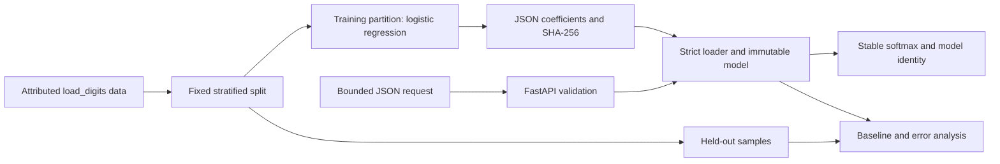

# PixelProof

A Python inference service that makes a trained model inspectable: validated JSON coefficients, bounded batch requests, a model digest on every response, and an evaluation that can be rerun without a training framework.

The example classifier recognizes low-resolution handwritten digits. The engineering problem is carrying an actual trained model from a fixed experiment into an API while preserving its behavior and documenting its failures. This is an educational model-serving project, not a production handwriting system.

## What works

- FastAPI endpoints and a CLI run offline with pure Python inference. scikit-learn and NumPy are optional training dependencies.
- The model loader rejects malformed dimensions, nonfinite or out-of-bound coefficients, duplicate JSON keys, unsupported metadata and checksum mismatches. It never loads pickle or joblib objects.
- Requests accept 1–32 images, each exactly 64 integer pixels in 0–16. The API counts streamed body bytes independently of Content-Length and caps them at 32 KiB.
- A fixed stratified split keeps 1,347 training samples separate from 450 held-out samples. All predictions, mistakes, split IDs, hashes and baseline results are checked in.
- Unit, integration, real HTTP, training and evaluation checks run in CI, alongside a nonroot Docker demo with external networking disabled.

## Run locally

Requires Python 3.11 or 3.13. Run commands from the repository root. No account, API key, environment variable or private data is needed. Installation needs access to PyPI; inference and the demo do not.

```bash
python -m venv .venv
# macOS/Linux:
source .venv/bin/activate
# Windows PowerShell instead:
# .\.venv\Scripts\Activate.ps1
python -m pip install -r requirements.lock
python -m pip install --no-deps -e .
python -m pip check
python scripts/demo.py
python scripts/evaluate.py
```

If PowerShell activation is restricted, use `.\.venv\Scripts\python.exe` in place of `python`, and `.\.venv\Scripts\pixelproof.exe` in place of `pixelproof`.

`demo.py` starts a temporary server bound to an available loopback port, checks health and model identity, submits three holdout images and a synthetic blank, checks rejection of invalid pixels, then shuts down. It includes a real mistake: sample 5 is labeled 5 and predicted as 9. It does not treat these examples as an accuracy measurement.

For an interactive server:

```bash
pixelproof serve
# Open http://127.0.0.1:8000/docs for endpoint information.
```

The POST endpoint uses a manual streamed parser to enforce strict JSON and byte limits; Swagger does not generate its request schema. Create a valid request from the attributed public holdout:

```bash
python -c "import json; from pathlib import Path; c=json.loads(Path('data/test_cases.json').read_text()); Path('example-request.json').write_text(json.dumps({'images':[c[0]['pixels']]}))"
pixelproof predict example-request.json
pixelproof info
```

Send that same file with `curl` (`curl.exe` in PowerShell):

```bash
curl -H "Content-Type: application/json" --data-binary @example-request.json http://127.0.0.1:8000/v1/predict
```

Configuration consists of CLI options: `pixelproof serve --host 127.0.0.1 --port 8000`. There are no secrets to configure. Binding to another interface does not add authentication or rate limiting.

## API contract

| Route | Result |
| --- | --- |
| `GET /health` | Status and model SHA-256 identity |
| `GET /v1/model` | Training metadata, class order and preprocessing; no coefficients |
| `POST /v1/predict` | `{"model_id":"…","predictions":[{"digit":4,"probabilities":[…]}]}` |

POST requires `Content-Type: application/json` and exactly `{"images":[[64 pixels], ...]}`. Pixels are flattened in row-major order. Booleans, floats, strings, out-of-range values and extra fields are rejected. Probabilities are in digit order 0–9. A tied maximum selects the lowest digit. The entire batch is validated before prediction.

| HTTP status | Meaning |
| --- | --- |
| 400 | Invalid UTF-8/JSON, duplicate keys, nonfinite numbers or excessive nesting |
| 413 | Body larger than 32 KiB |
| 415 | Unsupported content type |
| 422 | Valid JSON with an invalid schema or pixel values |

Invalid input is not echoed. The application stores no submissions and disables access logs in its CLI server. Infrastructure added by a deployer may have separate logging behavior.

## Architecture



`training.py` fixes normalization at pixels/16 and fits multinomial logistic regression. `model.py` checks the artifact, converts parameters to immutable tuples, then computes dot products and stable softmax. `api.py` loads the model once at application creation and dispatches bounded prediction work through the thread pool. `scripts/evaluate.py` independently recomputes frozen-model metrics and checks recorded probabilities, hashes and split consistency.

A checksum identifies exact bytes and detects a mismatch against an expected digest. It is **not a signature**: changing both files defeats that check. Review the source of an artifact before trusting it. The API has no model upload or reload endpoint.

## Measured experiment

The committed model was trained with scikit-learn 1.9.1 and NumPy 2.4.6. The split and configuration were fixed before scoring: seed 42, stratified 75/25 split, sorted indices, `C=1`, `solver=lbfgs`, `max_iter=1000`, `tol=1e-4`. No test-set tuning or refit on the holdout was performed.

| Model | Correct / 450 | Accuracy | Macro-F1 | Multiclass log loss |
| --- | ---: | ---: | ---: | ---: |
| Logistic regression | 433 | 96.22% | 0.961990 | 0.161545 |
| Training-majority baseline (always 3) | 46 | 10.22% | 0.018548 | Not evaluated |

These are measurements on a small random split of the bundled `load_digits` data, **not** the official UCI benchmark or evidence of general handwriting accuracy. Writer IDs are unavailable, so the split does not establish writer-independent performance. Probabilities are uncalibrated. A blank image receives digit 4 with probability 0.7808, demonstrating that a confident answer can be meaningless.

See the [model card and error analysis](docs/model-card.md), [complete machine-readable evaluation](docs/evaluation.json), and [dataset attribution](data/README.md). The evaluation includes all 17 error IDs, the 10×10 confusion matrix and every held-out prediction. No throughput or deployment claim is made.

## Test, build and retrain

```bash
python -m ruff check .
python -m ruff format --check .
python -m pytest --cov=pixelproof --cov-report=term-missing
python -m build
```

The default environment intentionally skips the training test module. To reproduce the experiment, install the additional pinned dependencies, run its tests, and write a new candidate directory:

```bash
python -m pip install -r requirements-training.lock
python -m pytest tests/test_training.py -q
python scripts/train.py candidate
```

The output directory must not already exist; no existing model or evidence is overwritten. The five generated files are `model.json`, `model.sha256`, `evaluation.json`, `split.json` and `test_cases.json`. A candidate is not automatically promoted into the service. Floating-point differences across platforms/BLAS implementations can change coefficients and their byte digest; bit-identical retraining is not promised. Training tests compare exported inference to that run's sklearn predictions across all 450 cases within `1e-10`. Frozen evaluation verifies the committed artifact separately.

Docker, when installed:

```bash
docker build -t pixelproof .
docker run --rm --network none pixelproof
docker run --rm --network none pixelproof python scripts/evaluate.py
# Optional local API, published only on loopback:
docker run --rm -p 127.0.0.1:8000:8000 pixelproof pixelproof serve --host 0.0.0.0
```

The container uses UID 10001, contains runtime dependencies only, and defaults to the HTTP demo. See [validation evidence](docs/validation.md) for the environments actually exercised.

## Decisions and limits

- Pure Python inference keeps installation small and coefficients inspectable. This fixed linear model does not need a general model runtime; it is not an approach for arbitrary neural networks.
- JSON avoids executable serialization, with strict limits and schema validation. Digests alone do not establish provenance or authorize an artifact.
- A simple baseline exposes the experiment's meaning. This familiar dataset tests the serving and evaluation workflow; the classifier is not novel research.
- There is no database, distributed queue, model registry, image upload decoder, authentication, rate limiter, drift detector, calibration or out-of-distribution detector. The default is local use. CPU and request limits bound individual work, not total concurrent traffic.
- Training and inference share the fixed `/16` preprocessing and class order. Independent probability comparisons guard against export mistakes. No result implies performance on other resolutions, orientations, handwriting sources or scanned documents.

## Learn and adapt

The [interview guide](docs/interview-guide.md) includes an architecture walkthrough, questions with answer notes, one modification exercise, and draft resume wording to adapt after reviewing and understanding the implementation. [Career fit](docs/career-fit.md) connects demonstrated skills to employer postings reviewed when this project was chosen.

This project was created with substantial AI assistance for design, implementation, tests, documentation and review. Training and reported evaluations were actually executed on the cited public dataset. Reviewing and extending the work yourself matters; the repository is not evidence of unaided authorship, employment, production traffic or business impact.

Code is MIT licensed. Dataset-derived holdout pixels and labels have separate CC BY 4.0 attribution in [data/README.md](data/README.md).
